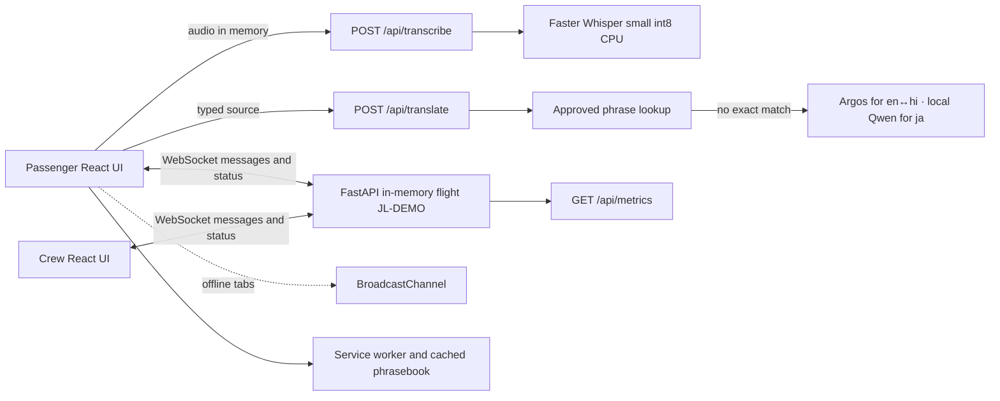

# CabinBridge

Local-first communication prototype for Japan Airlines problem JAL-PS-02: helping passengers and crew communicate across language barriers, accents, hearing/speech needs, and noisy or disconnected cabins.

## Run locally

Use the existing prepared environment; the app runs fully local. Setting `JEV_API_KEY` is optional: it enables the Jev decision API for crew triage summaries (see [SETUP.md](SETUP.md)); without it, a built-in local classifier is used.

This checkout has no `frontend/node_modules`. If the frontend dependencies are not already provisioned on your machine, run `cd frontend && npm install` once before `npm run dev`. No new package is required by the implementation.

```sh
cd backend
source .venv/bin/activate
uvicorn app.main:app --reload --port 8000
```

In a second terminal:

```sh
cd frontend
npm run dev
```

Open the local Vite address, normally `http://localhost:5173`. Vite proxies `/api` and `/ws` to the local FastAPI server. More detail: [SETUP.md](SETUP.md).

## Architecture



All request/session data lives in backend process memory for one demo flight. Restarting the backend clears it. There is no database or remote service.

## Language support

| Language | Code | ASR | Live translation | Browser TTS | Phrasebook |
|---|---|---:|---:|---:|---:|
| English | en | Yes | Yes | If voice installed | Yes |
| Japanese | ja | Yes | Yes, local Qwen via Ollama (ja→hi via English) | If voice installed | Yes |
| Hindi | hi | Yes | Yes, via English pivot to Japanese | If voice installed | Yes |
| Thai | th | Yes | Phrasebook/original fallback | If voice installed | Yes |
| Vietnamese | vi | Yes | Phrasebook/original fallback | If voice installed | Yes |
| Indonesian | id | Yes | Phrasebook/original fallback | If voice installed | Yes |
| Filipino/Tagalog | tl | Yes | Phrasebook/original fallback | If voice installed | Yes |

Faster Whisper small provides local transcription for the seven listed languages. Argos handles English↔Hindi; Japanese pairs use a local Qwen 2.5 model through Ollama, with ja↔hi bridged through English. Other language pairs use the approved phrasebook and preserve the original text. Browser TTS availability depends on installed browser voices.

## Safety, privacy, and accessibility

- Urgent actions send a predefined WebSocket event directly. They do not pass through ASR or translation.
- The passenger sees source and target text together. Editable transcript is reviewed before voice send.
- Empty, too-short, or low-confidence speech shows a retry/card prompt; the app does not guess.
- Audio is processed in memory and discarded; this prototype does not persist recordings.
- Safety instructions are restricted to `shared/approved_phrases.json` entries marked `category: safety` and `approved: true`. They are never translated live and display an Airline-approved badge.
- Negations, allergy terms, and numbers are highlighted in message previews.
- Text-size, contrast, reduced-motion, Simple mode, and speech-speed controls are available. Text and phrase-card paths remain available when voice is unavailable.
- Allergy and medical phrases are communication assistance, not medical advice. Phrase translations require native-speaker review before any operational use.
- With no server-confirmed crew delivery, the interface says Not delivered and directs the passenger to the overhead call button or to raise a hand.

Passenger Side Home Page


Crew Members Side Home Page


## Demo and measurement plan

Use `/demo` for a Hindi routine request, unclear audio guidance, urgent delivery failure, and offline instructions. Enable simulated crew-link failure from the Crew screen to demonstrate a not-delivered state. `/metrics` reports the latest 50 request records, per-step latency, median/p95, and fallback counts. The noise helper generates looping brown noise locally using Web Audio.

Before a pilot, evaluate with consented, non-sensitive recordings and scripted interactions:

1. Measure word error rate separately for English, Japanese, and Hindi across quiet speech, varied accents, cabin-noise levels, and short utterances.
2. Record ASR, translation, and end-to-end latency percentiles on the intended local hardware, including a cold model start.
3. Measure task completion, time to crew acknowledgement, repeat/edit/card fallback rate, and errors involving negation, numbers, allergies, and urgent requests.
4. Conduct accessibility sessions with older adults and people with hearing or speech impairments; record completion and usability feedback by task.
5. Verify every safety instruction against airline-approved wording and have all phrase translations reviewed by native speakers.

No benchmark or user study has been run as part of this implementation.

## Limitations

- Single process, in-memory state; no production persistence, authentication, multi-flight routing, or operational alert integration.
- A local server and browser connection are needed for voice recognition and live translation. Offline use is limited to the cached UI, phrase cards, browser speech where available, and same-device tab sync.
- Browser speech recognition is not used. Whisper recognition quality varies by language, accent, noise, and microphone.
- Delivery means a connected crew client received the WebSocket event, not that a crew member saw or acted on it. Acknowledgement is a separate state.
- Safety approval is a demo allowlist check, not a JAL certification or operational safety system.
- Phrase translations were machine-assisted/curated for a prototype and need native-speaker review.

## License notes

The application source is provided for the hackathon prototype. Faster Whisper and the Whisper model are MIT-licensed; Argos Translate is open source and its downloadable language packages may carry package-specific terms. React, Vite, FastAPI, and Uvicorn have their own open-source licenses. Review dependency and model-package licenses before redistribution or operational use.

## One-page pilot proposal

**Goal:** assess whether a local, phrase-first communication aid helps passengers and cabin crew complete routine and urgent communication in multilingual and noisy-cabin situations.

**Pilot shape:** after airline, privacy, accessibility, and safety review, run a limited supervised usability pilot on one training flight or cabin simulator. Include English, Japanese, and Hindi speech flows plus phrasebook-only Thai, Vietnamese, Indonesian, and Filipino scenarios. Use approved non-emergency scripts; never substitute the prototype for standard crew procedures or emergency call systems. Collect only task outcomes and latency; do not retain audio or identifying passenger data.

**KPIs:** task completion rate by language and task; median time to successful communication; median time from urgent send to crew acknowledgement; repeat requests per completed interaction; card/typed fallback rate; ASR word error rate by noise condition; translation correction rate; crew-rated usefulness and confidence; accessibility task completion by participant group.

**Decision gate:** proceed only if all safety phrases are approved, urgent delivery state is understood by users, accessibility participants can complete equivalent non-voice tasks, and agreed completion/latency targets are met. Define numeric targets with JAL stakeholders before the pilot; this prototype does not set or claim airline thresholds.
